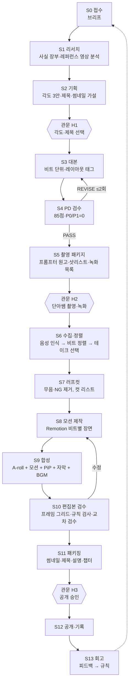

# HARNESS — 단아쌤TV 영상 자동 제작 하네스 v0.1

이 문서는 에이전트가 읽고 실행하는 작업 지침이다. 기획·집필·PD 검수 부분은
노션 「스킬｜세진 PD 영상 제작 하네스 v1.2」(이하 **세진 v1.2**)를 그대로 따르고,
이 문서는 그 위에 **촬영 이후의 제작 단계**와 **사람 개입 설계**를 덧붙인다.
두 문서가 충돌하면 기획·집필·검수는 세진 v1.2를, 촬영 이후 단계는 이 문서를 따른다.

---

## 0. 설계 원칙

1. **사람은 병목이 아니라 관문이다.** 사람은 정해진 3개 관문(§3)과 자동 정지 조건(§6)에서만 개입한다.
   그 외 단계에서 "확인해 주세요"로 멈추지 않는다. (알렉스: "I become the bottleneck. The system should run without me.")
2. **피드백은 한 번만 준다.** 사람이 준 수정 지시는 그 영상만 고치고 끝내지 않고,
   `rules/feedback-rules.md`에 규칙으로 남겨 다음 영상부터 자동 적용한다.
3. **비트가 최소 단위다.** 대본·촬영·컷·모션·자막·검수가 모두 같은 `beat_id`로 연결된다 (`schemas/beat.schema.json`).
4. **목소리와 얼굴은 진짜다.** 단아쌤이 직접 읽고 직접 찍는다. 목소리 복제·가짜 얼굴로 본편을 대신하지 않는다.
5. **실제 제품 화면은 녹화로만 보여준다.** 모션으로 실제 UI를 흉내 내지 않는다 (`danasam-tech-explainer` 규칙 승계).
6. **만든 사람이 자기 결과를 승인하지 않는다.** 검수는 깨끗한 맥락의 별도 에이전트가 한다 (세진 v1.2 §3).

---

## 1. 파이프라인



| 단계 | 담당 역할 | 입력 | 산출물 (run 폴더 기준) | 통과 기준 |
|---|---|---|---|---|
| S0 접수 | 총괄 | 사용자 요청 | `brief.md`, `state.json` | 주제·길이·광고 여부·마감이 적혀 있음 (모르면 세진 v1.2 기본값) |
| S1 리서치 | 리서처 | 브리프 | `research/facts.md`(사실 장부), `research/refs.md` | 세진 v1.2 §5 리서치 계약 |
| S2 기획 | 기획자 | 리서치 | `plan/angles.md`, `plan/titles.md` | 각도 3안 + 추천 1안, 제목 5개, 썸네일 3안 |
| S3 대본 | 작가 | 확정 기획·사실 장부 | `script/beats.json`, `script/script.md` | 모든 비트에 `layout`·`visual` 지정, 20~30초 이상 말만 이어지는 구간 없음 |
| S4 PD 검수 | 독립 PD | 브리프·사실 장부·대본 | `review/pd-vN.md` | 세진 v1.2 §8 (85점↑, 열린 P0/P1 0개) |
| S5 촬영 패키지 | 제작 설계자 | PASS 대본 | `shoot/prompter.txt`, `shoot/shotlist.md`, `shoot/record-list.md` | 프롬프터 원고가 비트 번호와 1:1 |
| S6 수집·정렬 | 편집자 | 촬영 원본·녹화 원본 | `edit/transcript.json`, `edit/alignment.json` | 비트마다 선택된 테이크 1개, 정렬 신뢰도 기록 |
| S7 러프컷 | 편집자 | 정렬 결과 | `edit/cutlist.json`, `edit/rough.mp4` | NG·중복 테이크 0개, 어미 잘림 0개 |
| S8 모션 제작 | 모션 디자이너 | 비트·컷 타이밍 | `motion/` Remotion 프로젝트, 장면별 MP4 | `design/` 규칙 위반 0개 |
| S9 합성 | 편집자 | 러프컷·모션·녹화 | `out/final.mp4`, `out/subs.srt` | 레이아웃 안전 영역 준수 |
| S10 편집본 검수 | QA (별도 에이전트) | 최종본·비트·규칙 | `review/edit-vN.md`, `review/grid-*.png` | §7 검수 체크리스트 전부 통과 |
| S11 패키징 | 패키징 담당 | 최종본·기획 | `package/` 썸네일·제목·설명·고정댓글·챕터 | 챕터는 **최종본 실제 타임코드** |
| S12 공개·기록 | 총괄 | H3 승인 | `state.json` 업데이트 | 공개 링크 기록 |
| S13 회고 | 총괄 | 사람 피드백·성과 | `rules/feedback-rules.md`에 새 규칙 | 피드백마다 규칙 1줄 이상 |

---

## 2. 상태 머신

세진 v1.2의 state 값을 그대로 쓰고, 촬영 이후 단계를 덧붙인다.

| state | 화면 상태 | 비고 |
|---|---|---|
| `intake` | 접수 | 세진 v1.2 |
| `research_complete` | 리서치 완료 | 세진 v1.2 |
| `concept_locked` | 기획 확정 | **H1 통과 후에만** |
| `script_draft` | 원고 초안 | 세진 v1.2 |
| `production_package_draft` | 제작·업로드 초안 | 세진 v1.2 |
| `pd_review` / `revision` | PD 검수 / 수정 | 세진 v1.2 |
| `document_ready` | 문서 납품 가능 = 촬영 패키지 완료 | 세진 v1.2 |
| `awaiting_footage` | 촬영 대기 | **H2.** 사람이 원본을 올릴 때까지 대기 |
| `footage_ingested` | 원본 정렬 완료 | 세진 v1.2의 `shoot_validation`에 해당 |
| `rough_cut` | 러프컷 완료 | 신규 |
| `motion_built` | 모션 장면 완료 | 신규 |
| `assembled` | 합성 완료 | 신규 |
| `edit_review` | 편집본 검수 | 세진 v1.2 |
| `publish_ready` | 공개 준비 | **H3** 대기 |
| `published` | 공개 완료 | 신규 |
| `retro_done` | 회고 완료 | 신규 |

- 상태가 바뀔 때마다 `state.json`을 저장한다 (`schemas/run-state.schema.json`). 연결이 끊기면 `state`와 `next_action`부터 이어 간다.
- 대본 버전이 바뀌면 그 뒤 단계의 산출물과 검수 판정을 모두 `stale`로 바꾼다. 다만 **촬영 후 대본 수정은 금지**다. 촬영 후에는 자막·모션 문구만 고친다.

---

## 3. 사람 관문 3개 (Human-on-the-loop)

| 관문 | 시점 | 사람이 하는 일 | 에이전트가 미리 준비할 것 | 기본 응답 시간이 지나면 |
|---|---|---|---|---|
| **H1 기획 선택** | S2 끝 | 각도 1개·제목 방향 선택 (1분) | 3안 비교표, 추천안과 이유 | 추천안으로 진행하지 않고 **대기** (방향은 사람만 정한다) |
| **H2 촬영** | S5 끝 | 프롬프터 보며 상반신 촬영, 화면 녹화 | 프롬프터 원고, 샷리스트, 녹화 목록, 준비물 | 대기 |
| **H3 공개 승인** | S11 끝 | 최종본을 폰으로 1회 시청, 승인 또는 수정 지시 | 최종본, 썸네일 3안, 업로드 키트, 검수 보고 | 대기 (자동 공개 금지) |

관문 사이에서는 사람에게 묻지 않고 진행한다. 진행 중 생긴 질문은 `state.json`의 `open_questions`에 모아 다음 관문에서 한 번에 묻는다.
H3에서 받은 수정 지시는 반영 후 **반드시** S13에서 규칙으로 바꾼다.

---

## 4. 역할과 인계

세진 v1.2 §3의 역할(총괄·리서처·기획자·작가·제작 설계자·패키징 담당·독립 PD)에 촬영 이후 역할 3개를 더한다.

| 역할 | 입력 (필요한 것만) | 편집 권한 |
|---|---|---|
| 편집자 | 촬영 원본, `beats.json`, `design/layout.md` | `edit/`, `out/` |
| 모션 디자이너 | `beats.json`(visual·props), 컷 타이밍, `design/` | `motion/` |
| QA | 최종본, `beats.json`, `design/`, `rules/` (**작성자의 자기평가는 주지 않는다**) | `review/` |

- 하위 에이전트를 쓸 수 있으면 S1 리서치, S8 모션과 S11 패키징은 병렬로 돌린다.
- 검수(S4, S10)는 항상 깨끗한 맥락의 별도 에이전트로 한다. 가능하면 다른 모델로 교차 검수한다 (예: Claude가 만들고 Codex가 검수).
- 노션 쓰기와 `state.json` 갱신은 총괄만 한다.
- 역할별 프롬프트는 `prompts/agents.md`에 있다.

---

## 5. 단계별 세부 계약 (촬영 이후)

### S5 촬영 패키지
- `prompter.txt`: 비트마다 `[B012]` 머리표 + 낭독 문장. 한 화면 2~3줄. 숫자·영어는 읽는 대로 적고, 괄호 안에 원표기를 남긴다.
- `shotlist.md`: 비트별 레이아웃(FACE/PIP/RECORD/CARD), 표정·제스처 메모(FACE 비트만), 의상·배경 체크.
- `record-list.md`: RECORD 비트마다 녹화할 화면, 입력값, 시작·끝 상태, 파일명 규칙 `R{beat_id}_{설명}.mp4`.
- 촬영 규칙은 `shoot/shooting-guide.md`를 첨부한다.

### S6 수집·정렬
1. A-roll(얼굴+목소리) 오디오를 단어 단위 타임스탬프가 있는 음성 인식으로 받아쓴다.
2. 받아쓴 내용을 `beats.json`의 `narration`과 비트 단위로 맞춘다 (퍼지 매칭).
3. 같은 비트를 여러 번 읽었으면 **마지막 완주 테이크**를 기본으로 고른다. 재촬영 신호(박수, "다시")가 있으면 그 앞 테이크는 버린다.
4. 원고와 다르게 읽은 곳(일치율 85% 미만)은 `alignment.json`의 `flags`에 남긴다.
   - 의미가 같으면 그대로 쓰고, 자막은 **실제로 말한 대로** 쓴다.
   - 사실·숫자가 틀리게 읽혔으면 P1으로 올리고 H3에서 보고한다 (재녹음 또는 자막 정정 중 하나).

### S7 러프컷
- 무음 처리는 `danasam-tech-explainer` §4-B 규칙을 따른다 (`-60dB` 기준, 첫소리 앞 0.12초, 어미 뒤 0.3초 유지, 빡빡한 `-45dB` 금지).
- 비트 사이 숨 고르기는 0.15~0.35초로 맞춘다. 강조 직전 비트는 0.5초까지 허용한다.
- 컷 지점이 단어 중간이면 안 된다. 단어 경계의 ±40ms 안에서 자른다.

### S8 모션 제작
- 비트의 `layout`과 `visual.component`대로 장면을 만든다. 사용할 수 있는 컴포넌트와 규칙은 `design/motion-grammar.md`에 있다.
- 장면 길이는 **러프컷에서 해당 비트들이 차지하는 실제 길이**로 정한다 (TTS 기준 길이가 아니다).
- 등장 타이밍은 `at: [비트 순서, 0~1 비율]` 대신 **단어 타임스탬프**에 맞춘다. 키워드가 화면에 뜨는 시점 = 그 단어를 말하기 시작한 시점 − 3프레임.
- PIP 레이아웃 장면은 오른쪽 아래 PiP 영역에 아무것도 그리지 않는다 (`design/layout.md` §2).

### S9 합성
- 1920×1080, 30fps, H.264 (CRF 18~20), 오디오 48kHz AAC 320kbps.
- 합성 순서 (아래에서 위로): 배경/모션 장면 → 화면 녹화 → PiP 얼굴 → 자막 → 워터마크.
- BGM은 대사 구간에서 −24 LUFS 근처로 낮추고(덕킹), 카드·전환 구간에서만 살짝 올린다. 최종 음량 −14 LUFS.

### S11 패키징
- 세진 v1.2 §7을 따른다. 썸네일의 얼굴은 **이번 촬영에서 뽑은 실제 프레임**이나 단아쌤이 제공한 사진만 쓴다.
- 챕터는 최종본 타임코드로 다시 계산한다. 촬영 전 예정 챕터를 그대로 쓰지 않는다.

---

## 6. 자동 정지 조건 (거버넌스)

아래 조건에 걸리면 진행을 멈추고 다음 관문 전이라도 사람에게 알린다. 나머지 가능한 작업은 계속한다.

| 조건 | 기본값 | 조치 |
|---|---|---|
| 유료 생성 크레딧 상한 | 롱폼 1편 **200크레딧**, 쇼츠 1편 **60크레딧** (단아쌤이 정할 값, `state.json.budget`) | 상한 도달 전 견적을 보이고 정지 |
| 같은 단계 재시도 | 2회 | `BLOCKED`로 기록, 가능한 범위만 납품 |
| P0 판정 (사실 조작·개인정보·위험한 지시) | 1건 | 즉시 정지 |
| 원고와 다르게 읽은 숫자·고유명사 | 1건 | 계속 진행, H3에서 보고 |
| 실제 계정·고객 정보가 화면에 보임 | 1건 | 블러 처리 후 H3에서 보고 |
| 인물 생성 (AI 캐릭터·아바타) | 생성 전 | 1장 만든 뒤 사람 확인을 받고 영상화 (알렉스 거버넌스) |

---

## 7. 편집본 검수 체크리스트 (S10)

QA 에이전트는 "좋다"가 아니라 항목별로 PASS/FAIL과 위치(타임코드·beat_id)를 남긴다.

**레이아웃**
- [ ] PIP 장면에서 PiP 영역과 겹치는 글자·도형이 없다 (장면 끝 −14프레임 그리드로 확인)
- [ ] 마지막 20초는 END 레이아웃이다 (YouTube 최종 화면 요소 자리 확보)
- [ ] 얼굴 PiP가 장면 전환마다 튀지 않는다 (위치·크기 고정)

**타이포·모션**
- [ ] 단어 중간 줄바꿈 없음 (`wordBreak: keep-all`)
- [ ] 화면 글자는 대본에 나온 말만 있다
- [ ] TTS용 한글 표기(엠피포 등)가 화면·자막에 없다
- [ ] 키워드 등장이 말보다 늦지 않다 (±3프레임)

**오디오·컷**
- [ ] NG·중복 테이크 0개
- [ ] 첫소리·어미가 잘린 곳 0개
- [ ] 최종 음량 −14 LUFS ±1

**사실·신뢰**
- [ ] 화면의 숫자가 사실 장부와 같다
- [ ] 실제 제품 화면을 모션으로 흉내 낸 곳이 없다
- [ ] 다른 채널의 로고·캐릭터·고유 디자인을 따라 한 곳이 없다
- [ ] 개인정보·계정 정보 노출 없음

**규칙 장부**
- [ ] `rules/feedback-rules.md`의 모든 규칙을 지켰다 (규칙 ID별로 확인)

---

## 8. 완료 보고 형식

매 관문에서 사람에게 보내는 보고는 아래 4줄을 넘지 않는다.

```
[상태] 편집본 검수 PASS → 공개 승인 대기 (H3)
[볼 것] out/final.mp4 (10:42), 썸네일 3안
[결정할 것] 썸네일 A/B/C 중 하나, 제목 추천안 승인 여부
[보고] 숫자 오독 1건(B031 "3만" → 자막 정정), 크레딧 사용 42/200
```
