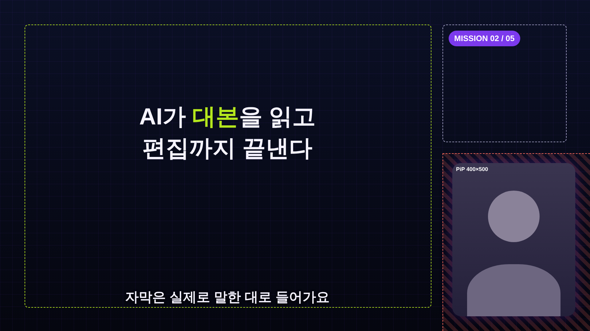
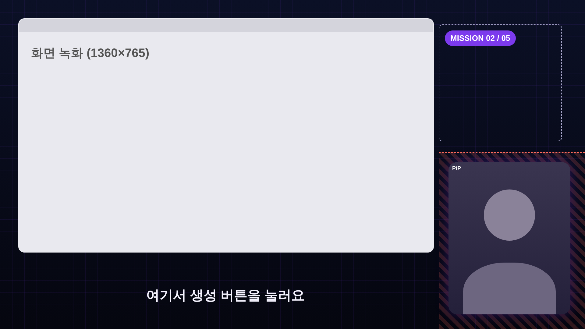
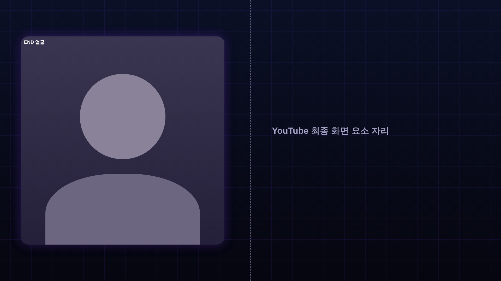

# 화면 레이아웃 — 얼굴 우측 하단 PiP 기준

캔버스는 1920×1080 (16:9), 30fps다. 좌표는 왼쪽 위 (0,0) 기준 px이고, 숫자는 `tokens.json`의 `layout`과 같다.

`tokens.json` 값으로 그린 미리보기 (연두 점선 = 콘텐츠 영역, 빗금 = 그리기 금지 영역):

| PIP | RECORD | END |
|---|---|---|
|  |  |  |

## 1. 레이아웃 5종

모든 비트는 아래 5개 중 하나의 `layout` 값을 가진다.

| layout | 화면 | 얼굴 | 쓰는 곳 | 영상 전체 비중 (목표) |
|---|---|---|---|---|
| `FACE` | 단아쌤 상반신 풀화면 | 크게 | 훅 첫 문장, 감정·의견, 솔직한 한계, CTA | 15~25% |
| `PIP` | 모션그래픽 풀화면 + 얼굴 PiP | 우측 하단 | 개념 설명, 비교, 흐름, 숫자 | 45~60% |
| `RECORD` | 화면 녹화 + 얼굴 PiP | 우측 하단 | 실제 시연, 설치, 결과물 | 영상 성격에 따라 |
| `CARD` | 풀화면 카드 (4초 이하) | 없음 | 수식 카드, 라운드 카드, 실습 프롬프트 카드, 전환 | ≤10% |
| `END` | 얼굴 왼쪽 + 오른쪽 빈자리 | 왼쪽 중간 크기 | 마지막 20초 (YouTube 최종 화면 요소 자리) | 마지막 20초 고정 |

같은 레이아웃이 60초 넘게 이어지면 중간에 다른 레이아웃을 넣는다. 다만 RECORD 시연은 흐름이 끊기면 안 되니 예외로 둔다.

## 2. 얼굴 PiP 규격 (PIP · RECORD 공통)

```
 0                                                    1920
 ┌──────────────────────────────────────────────────────┐ 0
 │  ┌───────────── 콘텐츠 영역 ───────────┐  ┌─칩 영역─┐  │
 │  │ x 80–1400 · y 80–1000              │  │1440–1840│  │
 │  │                                    │  │ 80–460  │  │
 │  │                                    │  └─────────┘  │
 │  │                                    │ ┌──────────┐  │ 532
 │  │                                    │ │  얼굴 PiP │  │
 │  │       (자막: 가운데 x=740, y≈990)    │ │ 400×500  │  │
 │  └────────────────────────────────────┘ │  r=28    │  │
 │                                         └──────────┘  │ 1032
 └──────────────────────────────────────────────────────┘ 1080
```

| 항목 | 값 |
|---|---|
| PiP 박스 | 400×500 (4:5 세로형), x 1472–1872, y 532–1032 (오른쪽·아래 여백 48) |
| 모서리 | radius 28 |
| 테두리 | 2px `rgba(255,255,255,0.14)` |
| 글로우 | `0 0 40px rgba(124,58,237,0.35)` (메인 보라) + 아래 그림자 `0 12px 32px rgba(0,0,0,0.45)` |
| **그리기 금지 영역** | x ≥ 1440 이고 y ≥ 500 (PiP + 여백 32px). 모션 컴포넌트는 이 영역에 글자·도형을 놓지 않는다 |
| 칩 영역 | x 1440–1840, y 80–460. 작은 라벨·배지·단계 표시(“MISSION 02/05”)만 놓는다 |
| 콘텐츠 영역 | x 80–1400, y 80–1000. 모든 PIP 장면의 본문은 이 안에 들어간다 |

**PiP 크롭 (원본 → 400×500)**
- 4K(3840×2160) 원본에서 4:5 박스를 잘라 쓴다. 박스 높이는 원본 높이의 80~90%(약 1800px)다.
- 얼굴 위치는 촬영 첫 10초의 얼굴 인식 중앙값으로 **한 번만** 정하고, 영상 내내 고정한다. 따라다니는 크롭은 쓰지 않는다 (어지러움).
- 정수리 위 여백은 박스 높이의 8~12%, 어깨선이 박스 아래 1/4 지점에 오게 한다.

**전환**
- FACE → PIP: 얼굴 풀화면이 12프레임 동안 PiP 자리로 줄어들고, 동시에 모션 장면이 페이드인한다 (`spring`, damping 18).
- PIP → FACE: 반대로 12프레임 동안 커진다.
- PIP ↔ RECORD: PiP는 그대로 두고 뒤 화면만 8프레임 페이드로 바꾼다. **PiP는 절대 깜빡이지 않는다.**

## 3. 레이아웃별 세부

### FACE
- 원본을 1920×1080으로 축소해 쓴다. 비트가 바뀌면 100% ↔ 112% 펀치인을 번갈아 써서 점프컷을 숨긴다.
- 자막: 가운데 아래, 기준선 y=990, 최대 폭 1400.
- 키워드를 띄울 때는 왼쪽 아래 1/3 영역(x 80–900, y 760–960)에 로워서드로만 띄운다. 얼굴을 가리지 않는다.

### PIP
- 배경은 Tech Dark (`tokens.json` `color.bgTop`→`bgBottom` 그라데이션 + 격자).
- 본문 중심축은 x=740 (콘텐츠 영역 가운데)이다. 화면 가운데(960)에 맞추면 PiP에 쏠려 보인다.

### RECORD
- 녹화 화면 박스: x 60–1420, y 60–825 (1360×765, 16:9). radius 20, 테두리 2px `rgba(255,255,255,0.10)`.
- 녹화 원본 해상도가 낮으면 확대하지 말고 박스 안에서 가운데 정렬한다.
- 강조는 박스 위에 라임 사각 하이라이트 + 커서 확대(1.6배)로 한다. 실제 UI를 다시 그리지 않는다.
- 자막: x=740 가운데, 기준선 y=990.

### CARD
- 얼굴 없이 4초 이하. 종류는 `motion-grammar.md` §2의 `EquationCard`, `RoundCard`, `PromptCard`, `RoadmapBoard`다.
- 자막 없음. 카드의 글자가 곧 자막이다.

### END (마지막 20초)
- 얼굴: x 80–860, y 140–940 (780×800 박스). 오른쪽 x 960–1880은 비워 둔다 (YouTube 최종 화면 요소: 다음 영상·구독 버튼 자리).
- 하단에 `EndCard`의 한 줄 문구만 둔다.

## 4. 자막

| 항목 | 값 |
|---|---|
| 폰트 | Pretendard Bold 44px, 흰색 `#F5F3FF` |
| 외곽 | 6px `rgba(5,6,15,0.85)` 스트로크 + 아래 그림자 |
| 한 줄 최대 | 22자 (PIP·RECORD), 28자 (FACE) |
| 줄 수 | 최대 2줄, 줄바꿈은 어절 단위 |
| 강조 | 비트의 `keyword`와 같은 단어만 라임 `#B4E61D` |
| 내용 | **실제로 말한 대로** 쓴다 (원고 기준이 아님) |
